<!--
  Every image in assets/ is generated, not hand-made: python3 tools/build_assets.py
  Edit the projects and awards in that script, re-run it, and commit the new files in assets/.
-->

  

  
  
  
   
  
  
  

  
  
  
   
  
  
  

  
  
  
  

  

