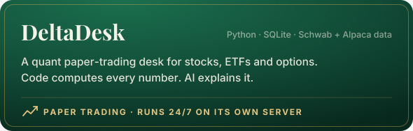
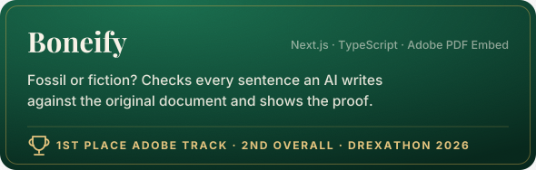
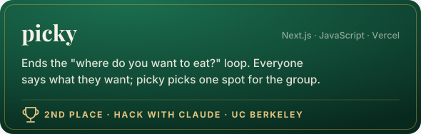
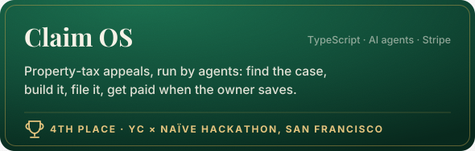

  

### Hey, I'm Nick 👋

Econ & DS at Berkeley. I build a lot of AI and trading stuff, and a few of my projects have placed at hackathons.

When I'm not clauding I'm probably fishing, playing poker or talking cars.

### The hand I'm playing

  
  
  
  

### Off the clock

  

♠ Always up for talking markets, data or a good hand.

