<!--
  Generated by tools/build_assets.py, like every image in assets/. Edit PROJECTS or AWARDS there and re-run:
  python3 tools/build_assets.py
-->

  

  
  
  
   
  
  
  

  
  
  
   
  
  
  

  
   
  

  

  

  

