<!--
  Every image in assets/ is generated, not hand-made: python3 tools/build_assets.py
  Edit the projects and awards in that script, re-run it, and commit the new files in assets/.
  Tiles are 2 per row; a tile links to its live demo (DeltaDesk links to its code; Plumb has no link).
-->

  

  
  <a href="https://afterhours-picky9.vercel.app/?demo"></a>

  <a href="https://boneify.vercel.app"></a>
  <a href="https://picky-ten-flax.vercel.app"></a>

  
  <a href="https://clawback-two.vercel.app"></a>

  
  <a href="https://second-look-zara.vercel.app"></a>

  
  <a href="https://github.com/nick-devvv/afterhours"></a>
  <a href="https://github.com/nick-devvv/boneify"></a>
  
  <a href="https://github.com/SmaranKudapa/picky"></a>
  <a href="https://github.com/SmaranKudapa/claimos"></a>

  <a href="https://github.com/nick-devvv?tab=repositories"></a>

  <a href="https://github.com/SmaranKudapa"></a>

